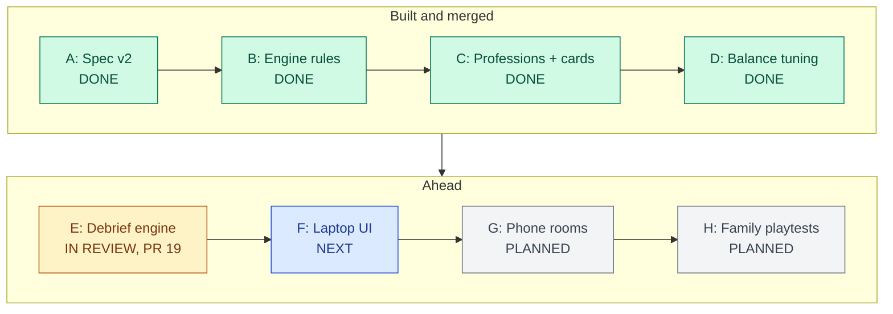
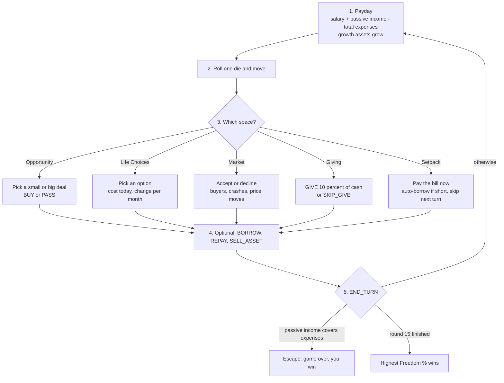
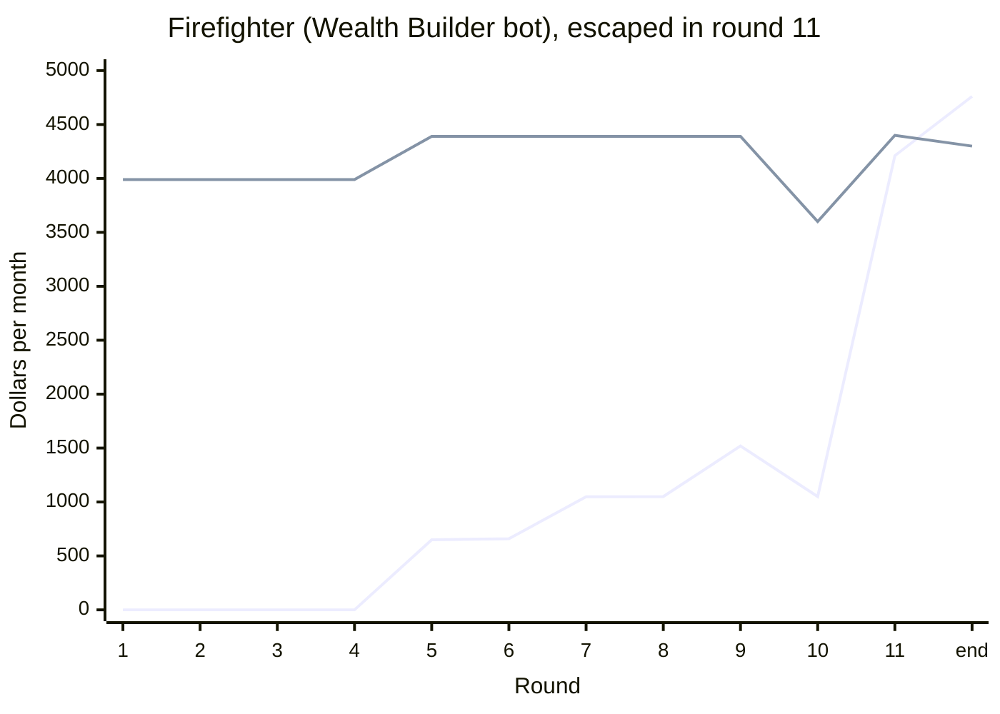
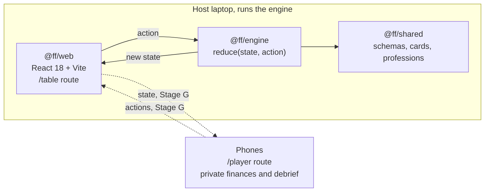
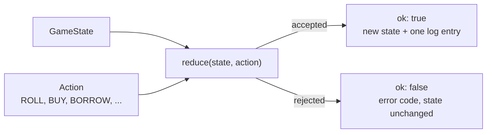
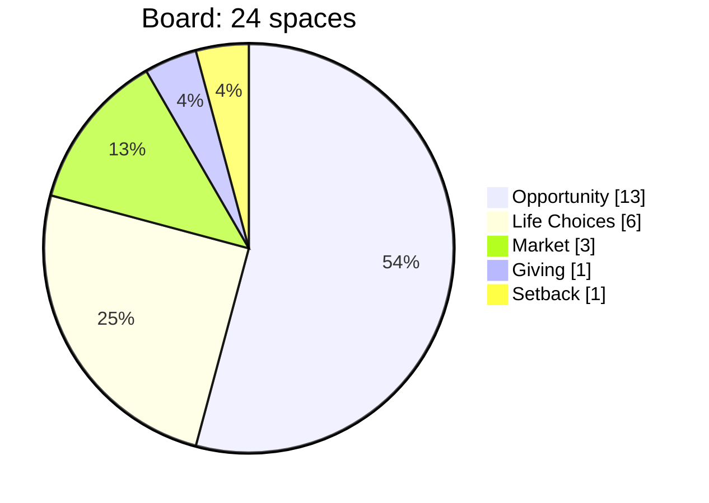
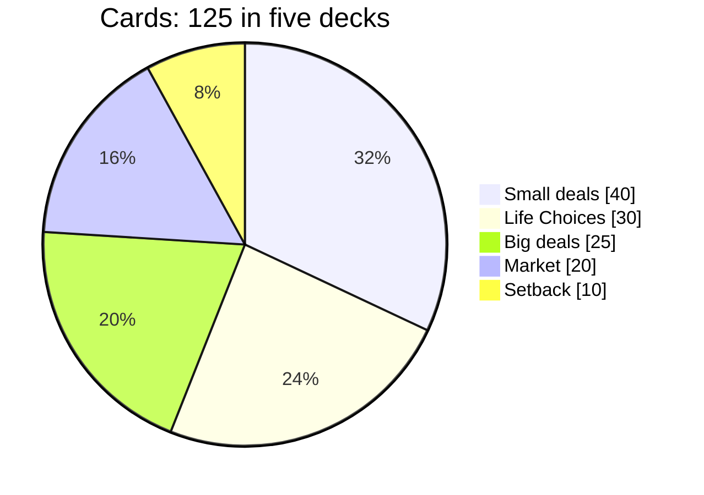

# Freedom Loop

A family cash-flow board game that teaches one idea: **you are free when the money your assets earn each month covers what you spend each month.**

The laptop or TV shows the shared board. Each player's phone shows their private finances, and at the end every player gets a personal debrief that explains, in dollars, why they won or lost. Adults and teens play standard mode; kids 7 to 10 play kids mode at the same table.

> **Status (2026-10-29):** the game engine, the content, and the balance tuning are done and merged. The debrief engine is in review ([PR #19](https://github.com/abeasley2020/financial-freedom/pull/19)). There is no playable screen yet. The web app is a placeholder until Stage F. [`STATUS.md`](STATUS.md) is the running log.

---

## Where things stand

The build follows eight stages, A to H, defined in [`docs/plan-wealth-edition.md`](docs/plan-wealth-edition.md). Each box says its status in words, so the colors are only a second cue.



| Stage | Work | Status | Where to look |
| --- | --- | --- | --- |
| A | Spec v2, the Wealth Edition rules | Done 2026-10-23 | [`docs/spec.md`](docs/spec.md) |
| B | Engine v2: Payday every turn, Life Choices deck, growth assets, 15-round limit, decision log | Done 2026-10-23 | `packages/engine/` |
| C | 16 professions and 125 cards | Done 2026-10-26 | [`docs/cards.md`](docs/cards.md), [`docs/content-notes.md`](docs/content-notes.md) |
| D | Balance tuning with the simulator; all ten targets met | Done 2026-10-27 | [`docs/sim/tuned.md`](docs/sim/tuned.md) |
| E | Debrief engine: `debrief(state, playerId, readingLevel)` plus text templates | In review | [PR #19](https://github.com/abeasley2020/financial-freedom/pull/19) and its `docs/debrief-samples.md` |
| F | Single-device web app: lobby, game screen, private debriefs by handing the device over | Next | starts after PR #19 merges |
| G | Rooms: phones join by a 4-letter code, private debriefs on each phone | Planned | Supabase Realtime |
| H | Three family playtests and polish | Planned | `docs/playtests/` |

**Open pull requests**

| PR | What it does | Waiting on |
| --- | --- | --- |
| [#19](https://github.com/abeasley2020/financial-freedom/pull/19) | Stage E debrief engine, templates, sample debriefs, and a fix to how END_TURN counts rounds when seats are skipped | Andre reads the sample debriefs and signs off on the round-limit wording in `docs/spec.md` |
| [#18](https://github.com/abeasley2020/financial-freedom/pull/18) | Records the Stage D question decisions in `STATUS.md` | Merge |

**What you can run today:** the full test suite (738 tests and 22 property tests on `main`; 824 and 30 with PR #19) and the balance simulator, which plays 1,000 bot games and prints the target table. You can't play the game in a browser yet.

---

## How a turn works

Every turn is one month. The engine enforces this order, so no step can be skipped.



**Freedom %** = passive income ÷ total expenses, rounded down. 100% means your assets pay all your bills, which ends the game at once. If nobody gets there, the game ends after round 15 (round 10 in kids mode) and the highest Freedom % wins.

### The money story

Each debrief draws two lines: what your assets paid each month, and what your bills were. The point where they cross is freedom. Here is a real one from the simulator: a Firefighter played by the Wealth Builder bot, from the Stage E samples in PR #19.



The line starting at $0 and climbing is passive income. The nearly flat line around $4,000 is total expenses. Passive income passed expenses at the end of round 11 ($4,761 against $4,300), so that player escaped and won.

---

## Architecture

One React app serves two routes. The engine runs only on the host laptop: screens send actions and render the state that comes back. No screen, hook, or store re-implements a game rule.



The engine has one entry point. A rejected action never throws and never changes state.



### The three engine rules

The full rules, and how each one is enforced, are in [`CLAUDE.md`](CLAUDE.md).

1. **The engine is pure.** No React, no `Math.random`, no `Date`, no mutation. Dice use a seeded PRNG whose position is stored in state, so the same start and the same actions always give a byte-identical game.
2. **No stored derived values.** Only facts live in state. Anything computable, such as `passiveIncome`, `totalExpenses`, or `freedomPercent`, is a selector in `packages/engine/src/selectors.ts`.
3. **Test-first.** Every action has a failing test before it has code. After every accepted action, property tests check the invariants: cash never negative, every card accounted for, only the current player acts, and replaying the log rebuilds the state.

The 13 actions: `ROLL`, `END_TURN`, `CHOOSE_DEAL_SIZE`, `BUY`, `PASS`, `SELL_ASSET`, `BORROW`, `REPAY`, `CHOOSE_LIFE_OPTION`, `ACCEPT_MARKET`, `DECLINE_MARKET`, `GIVE`, `SKIP_GIVE`.

---

## Repository map

```text
financial-freedom/
├── CLAUDE.md                    engineering rules (read first)
├── STATUS.md                    running log: what is done, what is next, open questions
├── docs/
│   ├── spec.md                  game rules, v2 Wealth Edition (source of truth for game design)
│   ├── plan-wealth-edition.md   build stages A to H and the prompt for each
│   ├── cards.md                 readable catalog of every profession and card
│   ├── content-notes.md         salary sources, card reasoning, tuning notes
│   └── sim/                     simulator reports; tuned.md is the Stage D result
├── packages/
│   ├── shared/   (@ff/shared)   types, Zod schemas, principles P1 to P10
│   │   └── src/data/            board.json, professions.json, cards/*.json
│   ├── engine/   (@ff/engine)   the pure game engine
│   │   ├── src/reduce.ts        the single entry point
│   │   ├── src/actions/         one file and one test file per action
│   │   ├── src/selectors.ts     every derived number
│   │   ├── src/invariants.ts    rules checked after every action
│   │   ├── src/test/golden/     five recorded games replayed exactly
│   │   └── sim/                 bots and the balance simulator
│   └── web/      (@ff/web)      React 18 + Vite app, placeholder until Stage F
└── scripts/cards-catalog.mjs    regenerates docs/cards.md
```

| I want to... | Open |
| --- | --- |
| Learn the rules | [`docs/spec.md`](docs/spec.md) |
| See what is done and what is next | [`STATUS.md`](STATUS.md) |
| Review card and salary realism | [`docs/cards.md`](docs/cards.md) |
| See the balance numbers | [`docs/sim/tuned.md`](docs/sim/tuned.md), [`docs/sim/tuning-log.md`](docs/sim/tuning-log.md) |
| Change engine code | [`CLAUDE.md`](CLAUDE.md) first, then `packages/engine/src/actions/` |
| Change a card or profession | `packages/shared/src/data/`, then rerun `node scripts/cards-catalog.mjs` |

---

## The game at a glance





| Deck | What it teaches |
| --- | --- |
| Small deals | Savings, CDs, index funds, stocks, small rentals, side hustles; $5,000 down or less |
| Big deals | Apartment buildings, car washes, franchises, land; $6,000 to $50,000 down |
| Market | Prices move, buyers appear, markets crash and recover |
| Life Choices | Vehicles, clothes, gadgets, subscriptions, windfalls. Every card shows cost today and change per month, and has an option with no monthly cost |
| Setback | Car repairs, medical bills, layoffs |

**16 professions:** Restaurant Server, Retail Manager, Truck Driver, Welder, Electrician, Teacher, Police Officer, Firefighter, Army Sergeant, Nurse, Farmer, Real Estate Agent, Software Developer, Engineer, Pharmacist, Doctor. Salaries are US median pay. Freedom % scoring puts every profession on equal terms.

**10 principles.** Every card, option, and decision carries principle tags, and the debrief speaks only in these ten ideas.

| | | | |
| --- | --- | --- | --- |
| P1 Emergency fund | P2 Assets vs. liabilities | P3 Cash flow beats looking rich | P4 Delayed gratification |
| P5 Good debt vs. bad debt | P6 Things lose value | P7 Small costs add up | P8 Compounding and patience |
| P9 Risk and diversification | P10 Generosity | | |

**Kids mode:** 10 rounds, small deals only (no single stocks), no borrowing, Setback spaces do nothing, round numbers, and simpler card text.

### Balance (Stage D, 1,000 simulated games per suite)

| Target | Goal | Result |
| --- | --- | --- |
| Games end by escape or the round limit | at least 70% | 99.7% |
| Seats that go bankrupt | at most 20% | 0.9% |
| Win rate per profession | 20% to 45% | 28.2% (Farmer) to 44.1% (Doctor) |
| Wealth Builder beats Big Spender head to head | at least 70% | 96.1% |
| Best strategy minus worst | at least 15 points | 44.9 points |
| Median game length | 10 to 15 rounds | 15 |
| Games that end by escape | at least 15% | 35.9% |
| Kids mode: nobody stuck, median length | 10 rounds or fewer | yes, 10 |

---

## Getting started

You need Node 24 (see `.nvmrc`; at least 22.12) and pnpm through Corepack.

```powershell
corepack enable
pnpm install
pnpm check
```

`pnpm check` is the gate before every commit: typecheck, lint with zero warnings, unit tests, and property tests.

| Command | What it does |
| --- | --- |
| `pnpm check` | typecheck + lint + test + test:props |
| `pnpm test` | all Vitest unit tests |
| `pnpm test:engine` | engine tests only |
| `pnpm test:props` | fast-check invariant suite, 1,000 runs |
| `pnpm sim` | 1,000 bot games per suite; prints the balance target table (`--summary` for the table only) |
| `pnpm dev` | Vite dev server with `--host` (shows the placeholder page until Stage F) |
| `pnpm build` | production build of the web app |
| `pnpm e2e` | not set up yet; Playwright and axe arrive with Stage F |

A Husky pre-commit hook runs typecheck and lint. There is no CI yet.

---

## Tech stack

| Layer | Choice | Status |
| --- | --- | --- |
| Language | TypeScript, strict | In use |
| Engine | Plain TypeScript and Zod, seeded mulberry32 PRNG | In use |
| Tests | Vitest and fast-check | In use |
| Web | React 18 and Vite | Scaffold only |
| UI | Tailwind CSS v3, shadcn/ui, Zustand (engine state only) | Stage F |
| End-to-end and accessibility | Playwright and axe-core, WCAG 2.2 AA | Stage F |
| Multiplayer rooms | Supabase Postgres and Realtime | Stage G |
| Hosting | Vercel | Not linked yet |

There are no accounts or logins, and the game makes no AI calls.

---

Freedom Loop is a personal family project, not for sale. All card content, names, and numbers are original.
